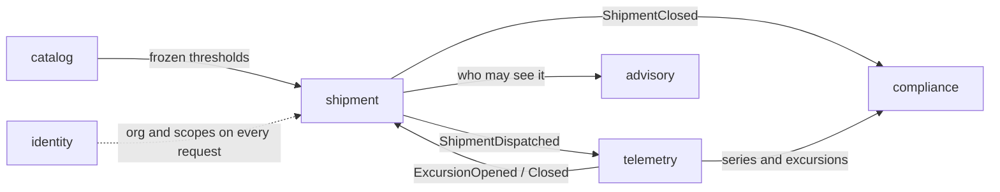

# ColdChain

[](https://github.com/jorge-lherrera/coldchain-api/actions/workflows/ci.yml)

Cold chain custody and compliance API. A pharmaceutical shipment passes from hand to hand between
organizations, its temperature is measured for the entire journey, and when it closes it **either has
a certificate or it doesn't**.

> **Status:** the six modules are built and closed, and a second service triages every excursion and
> sends its advice back. The whole system runs with Docker Compose or in a local Kubernetes cluster,
> and CI walks the demo both ways. Every rule in the catalogue has a machine that checks it, and the
> integration suite runs against a real Oracle raised from nothing on every push.
> The specification lives in [`docs/specification.md`](docs/specification.md), the decisions in
> [`docs/adr/`](docs/adr/), and the order the work was done in
> [`docs/branching-plan.md`](docs/branching-plan.md).

## The problem

A batch of vaccines leaves a lab, a carrier picks it up, it stops at an intermediate warehouse, a
second carrier picks it up and it arrives at a hospital. Four different organizations have held the
box, and **none of them takes another's word for it**. At the end of the journey somebody has to
answer two questions, with evidence:

1. Did the batch stay within its temperature range?
2. Who was holding it at any given moment?

This project answers those two questions and nothing else.

## Why this domain

The domain was chosen because it forces three problems a CRUD app never has to face:

- **Several organizations see the same shipment without owning it.** Visibility across organizations
  has to be solved without inventing an organization tree — see
  [ADR-003](docs/adr/ADR-003-visibility-by-participation.md).
- **The verdict is real arithmetic** over a time series: cumulative minutes out of band, data
  coverage. It is not a boolean somebody ticks by hand.
- **Readings arrive in volume, out of order and repeated.** Idempotent ingestion, indexes and
  partitioning stop being decoration.

## The six modules

They are numbered by dependency: that is also the build order.

| # | Module | Responsibility |
|---|---|---|
| 01 | `identity` | Organizations, users, roles and scopes. Who is asking, and with what permission. |
| 02 | `catalog` | Storage profiles, products and sites. What is shipped and under what conditions. |
| 03 | `shipment` | The shipment, its chain of custody and who can see it. |
| 04 | `telemetry` | Devices, temperature readings and excursion detection. |
| 05 | `compliance` | The certificate, its verdict and the findings that back it. |
| 06 | `advisory` | The advice the triage service sends about each excursion, apart from the verdict. |



Modules talk to each other through domain events, synchronous and in-process. **No `join` crosses a
module boundary:** references go by UUID and reads go through the owner's `api/`. Each module declares
its allowed dependencies in code — `@ApplicationModule(allowedDependencies = {...})` — and an import
that is not on the list **fails the build**.

Inside a module the shape is hexagonal: a pure-Java domain model, a repository port it declares, and an
adapter implementing it over JPA. The business rules — the state machine, the verdict arithmetic, the
excursion detection — are plain objects, so they are unit-tested in milliseconds with no database
anywhere near them. That is the point of it, and the reasoning is in
[ADR-007](docs/adr/ADR-007-hexagonal-module-internals.md).

## Excursions leave through Kafka

Inside the monolith those events stay in-process. Outside it nobody would hear them, so
`ExcursionOpened` and `ExcursionClosed` also leave as integration events on
`coldchain.telemetry.excursion.v1`, keyed by shipment: every event of a shipment lands on the same
partition, in the order it happened.

They go out through an **outbox**. Spring Modulith stores the event in the same Oracle transaction as
the excursion and sends it to Kafka after the commit, so a rollback publishes nothing, and a broker
that is down delays the feed instead of losing it. Delivery is at-least-once: every message carries a
stable `eventId` so a consumer can drop the copies, and the close of an excursion carries the same
`excursionId` as its open. The reasoning, and what was ruled out, is in
[ADR-009](docs/adr/ADR-009-kafka-for-integration-events.md).

## Advice comes back, and never reaches the verdict

`coldchain-triage`, a second service with its own PostgreSQL, reads that feed. When an excursion
closes it asks the API what was happening around it — the readings, the frozen thresholds, who held
custody — and asks a language model for a probable cause, how serious it looks and what to do next, in
English, Spanish and Portuguese. When the model is not configured, does not answer, refuses or answers
outside the schema, the rules answer instead, and the alert says which one did. The alert goes back to
the API on `coldchain.triage.alert.v1`, through an outbox again, and the sixth module, `advisory`,
shows it to whoever takes part in the shipment.

The model's answer is advice, not evidence: it can be wrong and it changes with the model. So
`compliance` cannot read `advisory`, and the build fails if it ever tries — Spring Modulith refuses the
edge and a rule in the catalogue names the two packages. Why the line is drawn there is in
[ADR-012](docs/adr/ADR-012-triage-is-advice-not-evidence.md); why it is a second service and not a
module is in [ADR-010](docs/adr/ADR-010-second-service-for-excursion-triage.md).

## Stack

- **Java 25** (LTS) and **Spring Boot 4**
- **Oracle Database 23ai Free**, schema governed by **Flyway** alone — no `ddl-auto`
- **Spring Modulith** + **ArchUnit** for the boundaries, backed by a rule catalogue that runs as a CI
  gate — see [`rules/`](rules/)
- **Testcontainers** with `gvenzl/oracle-free` — a real Oracle in the integration tests, not H2
  pretending to be Oracle
- **Apache Kafka** for the excursion feed out and the advice back, both published through Spring
  Modulith's event externalization and its JPA event publication registry
- **Spring AI** with Claude for the triage, behind a port, with rules that answer whenever the model
  does not
- Spring Security with our own JWT, OpenAPI, Docker Compose
- **Kubernetes** on kind for the second way to run it: Kustomize, Kafka through **Strimzi**, and the
  **Gateway API** served by **Envoy Gateway**
- Every message the API answers with travels as a key and resolves in **English, Spanish and
  Portuguese**, chosen by `Accept-Language`

The reasoning is in [ADR-001](docs/adr/ADR-001-oracle-23ai.md) and
[ADR-006](docs/adr/ADR-006-modules-and-events.md).

## What this project enforces

Everything from the folder down to the field is declared in
**[`rules/project-rules.md`](rules/project-rules.md)** — every rule across sixteen groups, each with a
severity, the test that checks it, and the state that test is in. It is not a style guide:
`./gradlew rules` runs it on every push and every pull request, and it has no switch to turn it off.

The catalogue verifies itself, too: a rule that cites a test that does not exist fails the build, a
rule still waiting for its test cannot quietly acquire one without moving its row, and a tolerated
violation with no owner and no expiry date fails as well. Nothing is left `planned`: the day a rule
was written without a machine is the day the build said so.

Writing those machines is what found the defects worth finding — an audit entry that came back from
the database with an identifier that was not its own, two concepts wearing two names each, four
columns abbreviated past the point of being guessable, and thirteen aggregates where the second
writer erased the first without a trace.

```bash
./gradlew rules      # the gate. Everything that does not need Oracle
./gradlew rulesDb    # the rules that can only be checked against a real database
```

## How to run it

```bash
cp .env.example .env             # local credentials, never committed
docker compose up -d --wait      # Oracle, Kafka, the API, and triage with its PostgreSQL
scripts/demo.sh                  # the whole story below, end to end
```

The stack answers at `http://localhost:8080/api`, and the contract it serves is browsable at
`http://localhost:8080/api/swagger-ui.html`.

### On Kubernetes

Docker Compose is the everyday path. The same system also runs in a local Kubernetes cluster, which
answers what Compose cannot: when an instance is alive but not ready, what happens to an excursion
when the pod that committed it dies, and how far the consumer can scale
([ADR-013](docs/adr/ADR-013-local-kubernetes-kind-kustomize-strimzi.md)).

```bash
cp .env.example .env                            # the same credentials Compose reads
scripts/k8s-up.sh                               # the cluster, its platform, both images, every workload ready
BASE_URL=http://localhost/api scripts/demo.sh   # the same walkthrough, through the Gateway
scripts/k8s-down.sh                             # the cluster and its volumes, gone
```

It needs Docker, kind and `kubectl`, and about 6 GB for the cluster.

- **One kind node**, with the manifests composed by Kustomize: a `base` and a `local` overlay.
- **Kafka run by Strimzi**, its four topics declared as `KafkaTopic` resources. Oracle and
  PostgreSQL run as `StatefulSet`s with a volume each.
- **The API and triage as `Deployment`s**: probes from the actuator, requests and limits, non-root
  on a read-only filesystem. A database that is down makes a pod not ready and never restarts it.
- **The API answers through a Gateway API route served by Envoy Gateway**, at
  `http://localhost/api`. Only the public prefixes are routed, so `/api/internal` answers `404` from
  outside.
- **Triage scales on CPU up to three replicas**, the partition count of its feed. A fourth would
  receive no partition and sit idle.
- **Running the script again changes nothing.** An image that changed rolls its own `Deployment`
  and nothing else.

CI runs the same script on a kind cluster on every push, runs it a second time to prove it changes
nothing, and walks the demo through the Gateway. The checks and the failure drills are written down
with what they showed in [plan 08](docs/plan-08-local-kubernetes.md#what-the-cluster-showed): the
API killed with an excursion in its outbox, triage killed mid-triage, and a duplicate the inbox
drops.

### Working on the code

Run the API from Gradle against the same database:

```bash
docker compose up -d oracle kafka   # the database and the broker
./gradlew bootRun                # Flyway migrates, then the API on 8080
```

```bash
./gradlew test                   # the domain in milliseconds, plus the rule gate
./gradlew integrationTest        # with Testcontainers, requires Docker
./gradlew rebuild                # a database from nothing: migrate, start, run everything
```

The domain suite is the one that proves the shape is worth its price: **69 tests in 87 milliseconds**,
with no Spring context and no database anywhere near them — the state machine, the verdict
arithmetic, the excursion detection, the temperature band, the custody hash chain, who held custody
at a given moment, and which advice wins when two arrive out of order. A rule in the
catalogue fails the build if a calculator loses its test, or if a domain test reaches for a framework.

## The demo

```bash
docker compose up -d --wait
scripts/demo.sh                  # needs curl and jq
```

One run of `scripts/demo.sh`, against the stack you just raised:

1. Three organizations register — a laboratory, a carrier and a hospital — and none of them can see
   anything that is not theirs.
2. The laboratory declares a `2 – 8 °C` profile, a product and a shipment of 400 vials, and dispatches
   it with a sensor attached. **The thresholds are frozen at dispatch**: changing the profile
   afterwards cannot change what this shipment was judged against.
3. The carrier accepts the handoff with a single-use code and custody changes hands.
4. The gateway pushes three hours of readings, one every five minutes, with a 45-minute excursion
   above 8 °C and a 65-minute blackout. **The same batch is sent again and comes back `REPLAYED`**:
   nothing is duplicated.
5. The hospital takes delivery — and nobody asks for a certificate, because closing the shipment
   already issued one:

```
verdict            FAIL
coverage           71.43 % of the expected samples
longest excursion  45 minutes
content hash       04ddb79e045da4d2d57c4d2e056577087e96fcd9eb4e50567028fd82196c96f5
finding            DATA_GAP · CRITICAL · {"coveragePercent":71.43,"minimum":80}
finding            EXCURSION_ABOVE_MAX · CRITICAL · {"durationMinutes":45,"peakCelsius":11.5}
```

6. Apart from the verdict, the advice about the excursion arrives from the triage service. Without a
   model key it comes from the rules; with one, from the model:

```
source             RULES
probable cause     UNKNOWN
severity           HIGH
summary            The temperature stayed above the maximum for 45 minutes. Highest reading: 11.5 °C.
what to do         Review the readings around the excursion with the holder of the shipment and record what caused it.
an organization that takes no part asks for it: 404
```

The script is not a narration: it fails if the verdict is not the one written above, or if the advice
never arrives. **It runs in CI
on every push**, against Oracle raised from nothing, and the OpenAPI document the API served during
that run is published as a build artifact.

## Documentation

- [`docs/specification.md`](docs/specification.md) — tables, features and rules for the six modules.
  It is the contract: if the code and this document contradict each other, one of them is wrong.
- [`docs/adr/`](docs/adr/) — the architecture decisions, with their context and what was ruled out.
- [`docs/branching-plan.md`](docs/branching-plan.md) — the build order, branch by branch.
- **Implementation plans**, one per module:
  [01 identity](docs/plan-01-identity.md) ·
  [02 catalog](docs/plan-02-catalog.md) ·
  [03 shipment](docs/plan-03-shipment.md) ·
  [04 telemetry](docs/plan-04-telemetry.md) ·
  [05 compliance](docs/plan-05-compliance.md) ·
  [06 advisory](docs/plan-06-advisory.md).
- **Phase two** — a second service that triages excursions with a language model, and Kubernetes:
  [07 triage](docs/plan-07-triage-service.md) ·
  [08 kubernetes](docs/plan-08-local-kubernetes.md), decided in ADR-010 to ADR-013. What is left is
  the evaluation of the model against a golden set of excursions, which needs a model key to run.
- **Data model** (draw.io):
  [`docs/coldchain-data-model.drawio`](docs/coldchain-data-model.drawio) — the 25 tables with their
  columns and relationships, and one page per module.

## License

MIT.
